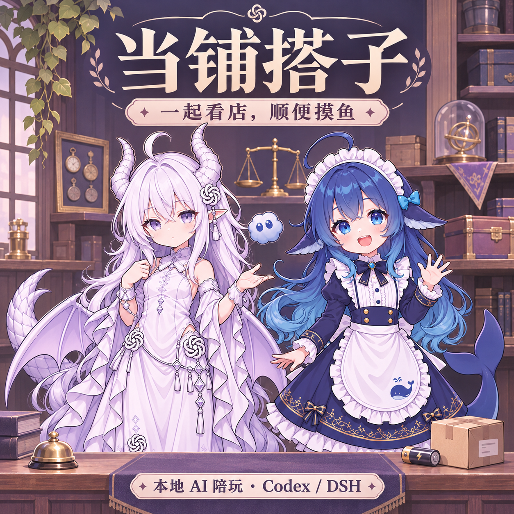

# 当铺搭子



给《Probably Stolen》找个搭子。一起看店、吐槽客人、研究机器，仓库太乱时顺便帮个忙。

**[工坊订阅](https://steamcommunity.com/sharedfiles/filedetails/?id=3838517317) · [下载接入包](https://github.com/Fat1aoGod/pawnshop-companion/releases/latest) · [Codex 说明](docs/CODEX.md) · [DSH 说明](docs/DSH.md)**

嫌安装麻烦，直接把这个 GitHub 仓库链接粘贴给你的 Agent，让它给你安装。两边分别附了 [Codex 安装说明](harness/README.md) 和 [DSH 安装说明](plugins/dsh-pawnshop-companion/README.md)，让它按你使用的工具读对应那份就行。

这套接入让 **你在 Codex 或 DSH 里已有的 Agent 会话** 进入游戏。不是新建一只失忆的 AI，也不要求你另买一份 API。模型用量仍由你所用的聊天工具计算。

## 里面有什么

- 游戏模组：左下角的 GPT 龙娘 / DeepSeek 鲸鱼娘。拖动位置，Ctrl + 滚轮缩放，右键或 F10 打开聊天与工具面板。
- Codex 接入：本地 MCP 服务，提供 26 个陪玩工具。
- DSH 接入：把游戏消息送到你选定的现有会话，支持后台等待和连续聊天。
- 本机桥接：把可见的游戏内容变成简短文字，伙伴不用一直看截图。

可以看日历、今日行情、已激活特性、难度和阵营声望，查看已解锁的黑市；也可以一次清点自有仓库和嵌套箱子、找物品、整理仓库、换现有电池，以及使用物品菜单和机器面板。具体能操作什么，在游戏「权限」页里勾选。

## 第一次使用

1. 订阅工坊里的「当铺搭子」，在游戏模组列表启用后重启游戏。它可以和「幻粉当铺」一起使用，也可以单独使用。
2. 下载并解压接入包到固定位置。**接入包放在游戏模组文件夹外面**；游戏只装 `pawnshop_companion`。
3. 安装 [Node.js](https://nodejs.org/) 22 或更新版本。发布的接入包已带依赖；如果下载的是源码，请在根目录运行 `corepack pnpm install --frozen-lockfile`。
4. 双击 `首次连接.cmd`，复制显示的连接码。进店后右键伙伴 →「显示」→ 粘贴连接码 → 保存。主菜单模组的齿轮里也可以填写。
5. 选择下面的一种接入方式，再在游戏里点「开始陪玩」。

同一时刻一位伙伴进店。Codex 和 DSH 用同一份接入包即可，不要同时占用同一局。

## 用 Codex 陪玩

在 Codex 设置中添加本地 MCP 服务：命令选择本机 `node.exe`，参数填解压目录里的 `harness/mcp.mjs` 的完整路径。`首次连接.cmd` 会按实际安装位置生成可复制的配置。

也可以用 CLI：

```powershell
codex mcp add pawnshop_companion -- node "你的解压目录/harness/mcp.mjs"
```

保存后重新加载 MCP，再在你想用的会话里说：「用当铺搭子接入我的游戏，以你现在的身份来陪我看店。」它先查找游戏，再连接，不会创建另一段模型会话。

参考：[Codex 官方 MCP 设置说明](https://learn.chatgpt.com/docs/extend/mcp?surface=app)。

## 用 DSH 陪玩

已在 DSH 0.2.2-rc.1 测试。插件目录为 `plugins/dsh-pawnshop-companion`，请保留它在接入包里的相对位置。

1. 结束当前一轮，在 DSH 的插件管理里添加这个本地插件目录，并启用它。若使用 CLI，见 [DSH 安装说明](docs/DSH.md)。
2. 将插件里的 `config.example.json` 复制为 `config.json`，把 `sessionId` 填成你希望陪玩的**现有会话 ID**。`displayName` 是进店后的显示名，可以自己改；默认「DeepSeek 搭子」。
3. 正常重启 DSH。打开选定的会话，在游戏里开始陪玩并说句话。

不确定 ID 时，可以把下面这段交给 DSH 里的 Agent：

> 请配置我解压的当铺搭子插件。以当前会话作为陪玩会话，只把当前会话 ID 写入插件 config.json 的 sessionId；保留示例里的其他选项。只改插件配置，不改会话历史、人设或记忆。配置好后告诉我需要重启 DSH。

伙伴可调用 `companion_wait_events` 陪着等一会儿，最多 45 秒；有消息就接着聊，没动静就自然结束这一段，后台继续等。玩家消息只投递一次，不用反复新开工具轮询。

## 几个常见情况

- **只有立绘，没有回复**：确认本地 MCP / DSH 插件已加载，游戏已点开始陪玩，连接码来自同一份接入包。仅订阅工坊不会自动连接模型。
- **本机端口的配对信息不一致**：通常是启动了两份不同目录的接入包。关闭另一份桥接，只保留固定目录里的这一份；连接码不需要每次重做。需要更换端口时，同时修改 `runtime/connection.json` 的 `port` 并重新运行首次连接，再把新码填入游戏。
- **更新后没变化**：重启游戏。游戏 Mods 里同 ID 的本地试玩版会盖过工坊版；使用订阅版时把本地试玩版移出 Mods。
- **伙伴说没权限**：在游戏面板的「权限」页勾选对应项目。
- **箱子清单旧了**：物品移动后让伙伴重新清点一次即可，不会在后台不停扫仓库。
- **想停止**：游戏点停止陪玩；DSH 那一轮还在等时可以正常结束。日常更新不需要删除你的会话。

## 数据和连接

游戏模组只向 `127.0.0.1` 的本机桥接发送数据。桥接本身不调用模型 API，也不读取其他聊天记录；游戏里的文字随后由你选用的 Codex / DSH 会话按其正常方式处理。

每份安装首次生成独立连接码，存放于本机 `runtime/connection.json`。不要公开这个文件。DSH 的 `config.json`、`binding-state.json` 也留在自己电脑；发布包均不包含这些文件。

## 开发与署名

作者：Fat1ao。程序、界面与 AI 辅助制作协作：Codex（OpenAI）。

角色设计与素材说明见 [CREDITS.md](CREDITS.md)。封面为宣传插画，实际界面以游戏内为准。本模组不是 OpenAI 或 DeepSeek 官方产品。

源代码构建与测试见 [开发说明](docs/DEVELOPMENT.md)。问题反馈：1461779749@qq.com，带上游戏和接入工具版本、出问题的步骤就好。
